
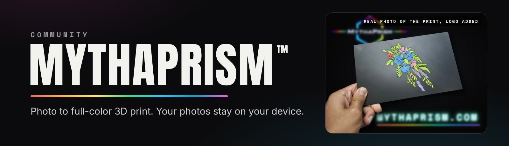

<a href="https://mythaprism.com"><b>Website</b></a> &nbsp;·&nbsp;
<a href="https://mythaprism.com/free"><b>Open the free tool</b></a> &nbsp;·&nbsp;
<a href="docs"><b>Guides</b></a> &nbsp;·&nbsp;
<a href="demos"><b>Video tutorials</b></a> &nbsp;·&nbsp;
<a href="https://mythaprism.com/manual.html"><b>Manual</b></a> &nbsp;·&nbsp;
<a href="../../issues/new/choose"><b>Report a bug or share a print</b></a>

MythaPrism turns a photo into a full-color 3D print. You edit the picture, match it to the filaments you own, look at it in 3D, and export a file that is ready to slice. It runs in your browser, and the phone apps are coming soon.

**Your photos stay on your device.** Editing, every color matcher, the 3D view and the export all run on your computer or phone. Your picture is never uploaded to us.

This repository is the public home for MythaPrism users. It holds no source code. Use it to report bugs, ask for features and show what you printed.

## From a painting to a print

| The painting | Edited in MythaPrism | The 3D preview | The print |
|:---:|:---:|:---:|:---:|
| 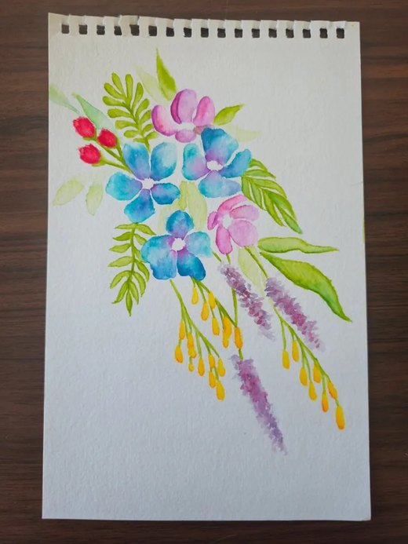 | 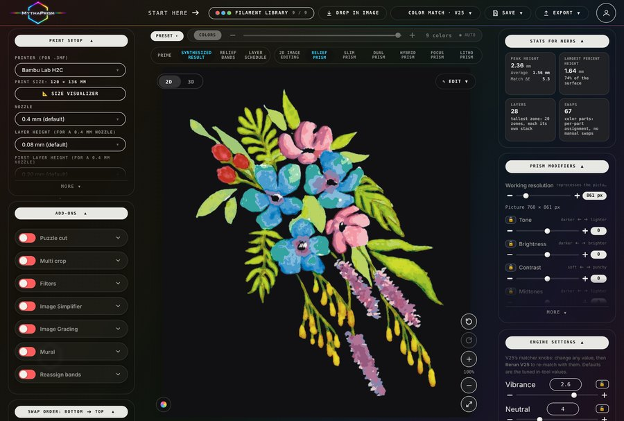 | 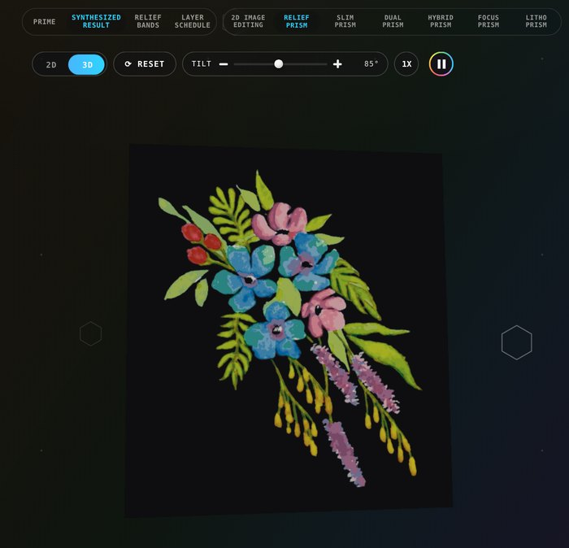 | 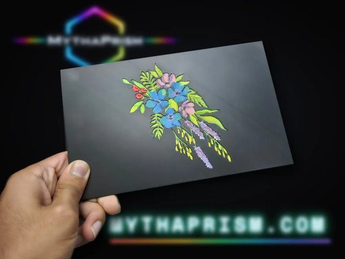 |
| A watercolor we licensed | Real screen capture | Real screen capture | Real photo, our logo added |

The preview is a close estimate of the print. Your printer, your spools and the light in the room all change the real print a little.

## Watch it

| Your first print | Edit before you print |
|:---:|:---:|
| <a href="demos/videos/01_your_first_print.mp4">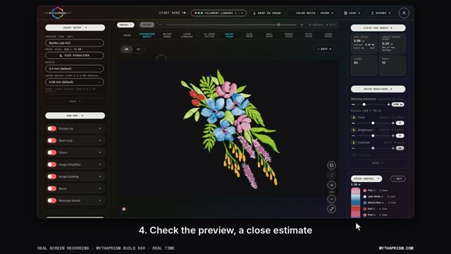</a> | <a href="demos/videos/02_edit_before_you_print.mp4">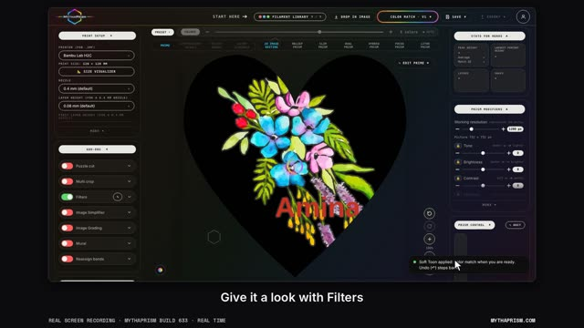</a> |

Real screen recordings of MythaPrism, played at real speed. More in [demos](demos).

## Your photos, printed

| The tiger, Sun and flowers prints | The tiger print |
|:---:|:---:|
| 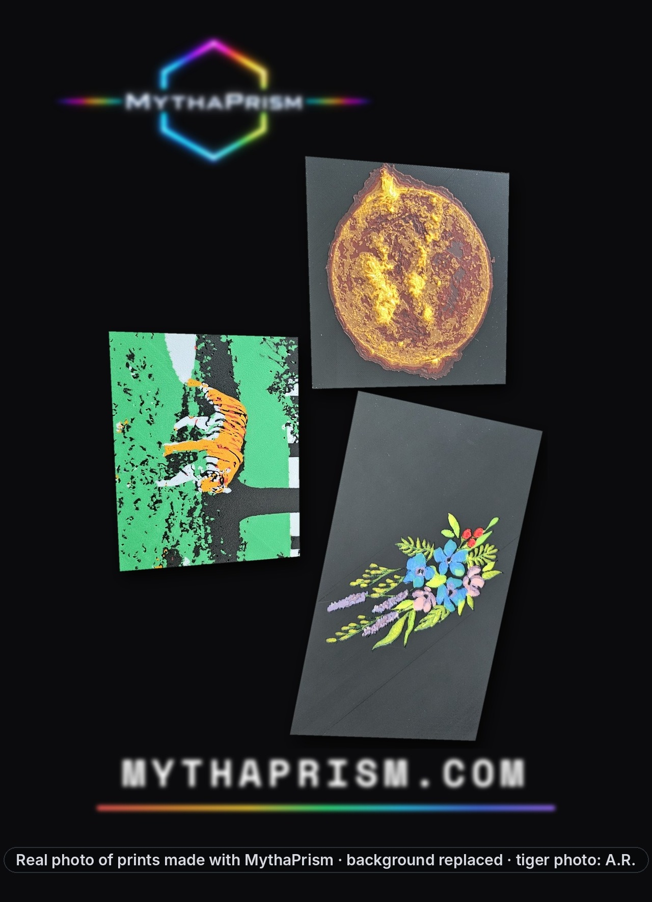 | 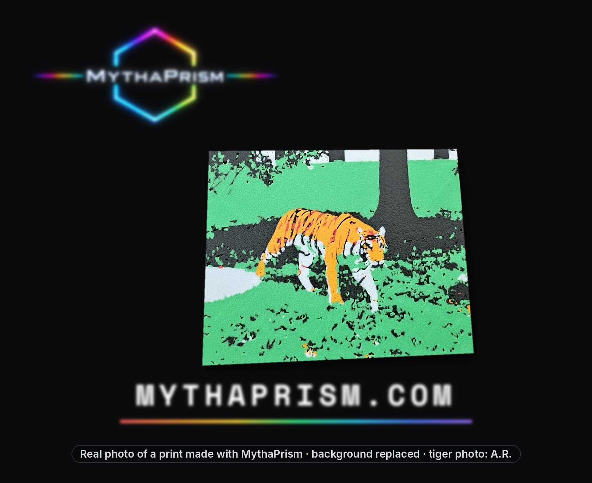 |

Real photos of real prints, the background replaced. Tiger photo: A.R., at the Virginia Safari Park, used with its permission. The dithered tiger up close and more are in [demos](demos).

## Print modes

| Relief | Slim | Dual |
|:---:|:---:|:---:|
| 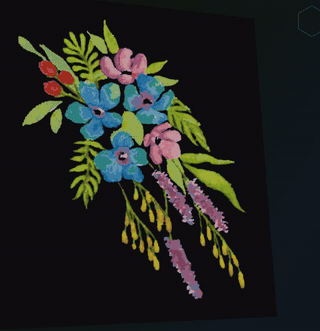 | 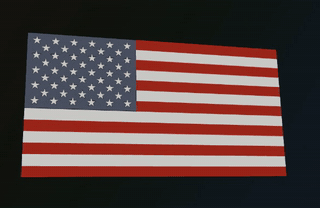 | 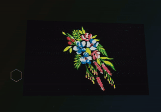 |
| **Hybrid** | **Focus** | **LithoPrism** |
| 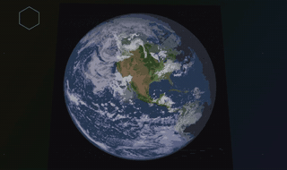 | 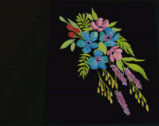 | 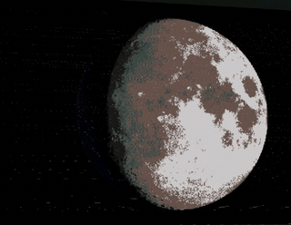 |

Real 3D previews, each turned by hand in the MythaPrism 3D view. The guide to every mode is in [docs/print-modes.md](docs/print-modes.md).

## Edit first, then print

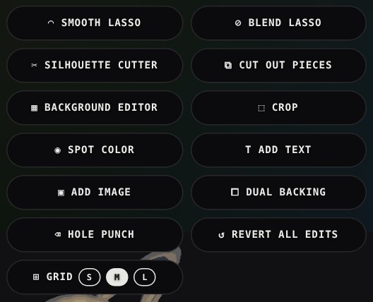

Every picture opens as a photo first. You can crop it to a shape, cut out the subject, change the background, add spot color and text, and use filters and grading before you match a single color. Then you pick a color matcher and MythaPrism works out which filament goes where.

 

## Many color matchers

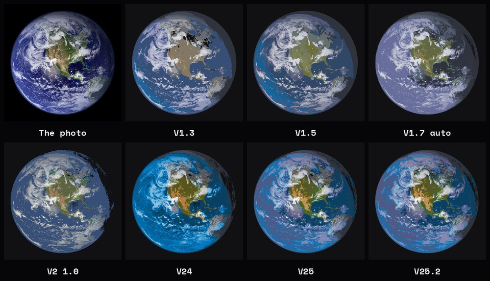

One photo of Earth matched by different color matchers, side by side (real screen capture). Each one plans the layers in its own way, so you can pick the look you like.

## Finish it in Blender

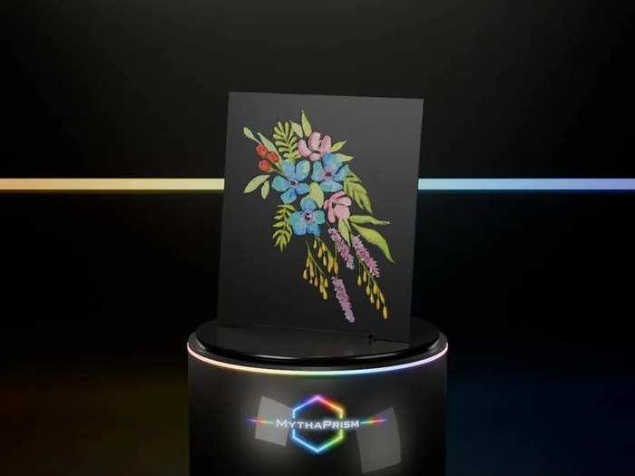

The MythaPrism Plug-in and Showroom for Blender brings your print into Blender with its real filament colors. You can build on it, light it on a turntable, and send the whole thing back to your slicer as one 3MF.

Blender render of a real MythaPrism export.

 

## MythaBraille

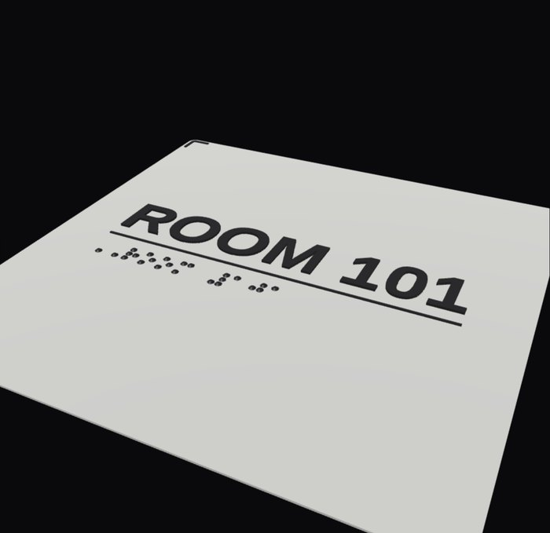

MythaBraille makes braille signs and labels you can print. It is free, and it runs in your browser at [mythaprism.com/braille](https://mythaprism.com/braille). Its own page is [MythaPrism/mythabraille](https://github.com/MythaPrism/mythabraille).

 

## Plans

You can try MythaPrism free. Plans, prices and what each one includes are on the [prices page](https://mythaprism.com/#pricing). Prices and terms are always shown before you pay.

## Guides, demos and sample prints

- [Guides](docs): getting started, print modes, edit tools, color matchers, export and slicing, the Blender plug-in, privacy and common questions.
- [Video tutorials and demos](demos): four short tutorials and every feature as its own real screen recording, played at real speed.
- [Sample prints](prints): ready-to-print files made in MythaPrism, so you can test your printer before you buy anything.
- [Manual](manual): the full manual as a PDF.

## How to get help

1. Search the [issues](../../issues) first. Someone may have asked already.
2. Open a new issue with one of the forms: a bug, an idea, or a print you made.
3. Questions about your account, a payment or a refund go to **support@mythaprism.com**, never into a public issue.
4. Found a security or privacy problem? Please read [SECURITY.md](SECURITY.md) and write to us privately.

Everything you post here is public. Please leave out personal details, and leave out any picture you want to keep private.

## Credits

The Earth picture is from NASA, and NASA does not endorse MythaPrism. The flower painting is used under license. Bambu Lab, Prusa, OrcaSlicer, Blender and other names belong to their owners and are used only to say what MythaPrism works with.

MYTHAPRISM™ is a trademark of MythaPrism LLC. Patent pending. See [LICENSE.md](LICENSE.md) for what you may and may not do with the contents of this repository.
