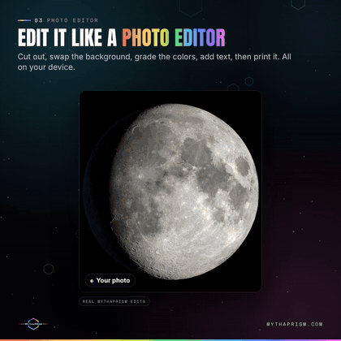

# Demos

Short clips from MythaPrism. Each one says what it is. The preview in each clip is a close estimate of the printed result.

## Auto color match: drop in a photo, match it to your filaments, then the same export on the Showroom stage

Real screen recording, then a Blender render of the export (not a photo of a print).

## The photo editor: cut out, background, grading, text and a heart crop

Real MythaPrism edits.

## See it in 3D: a Dual print turned in the 3D view

Real screen recording.

## Pick a print mode: Relief, Slim, Dual, Hybrid, Focus and LithoPrism

Real 3D previews turned by hand.

## Any photo, full color: space photos and paintings matched to filaments

Real MythaPrism output, NASA pictures (public domain, NASA does not endorse MythaPrism).

The full demo video, recorded in real time, is on the [website](https://mythaprism.com/#demo).
