# Demos

Every video here is a real screen recording of MythaPrism build 633, played at real speed with nothing sped up. The words on screen say what each step is. The preview in each clip is a close estimate of the printed result. Click a picture to open its video.

## Short tutorials

| Video | What it shows |
|:---:|:---|
| <a href="videos/01_your_first_print.mp4">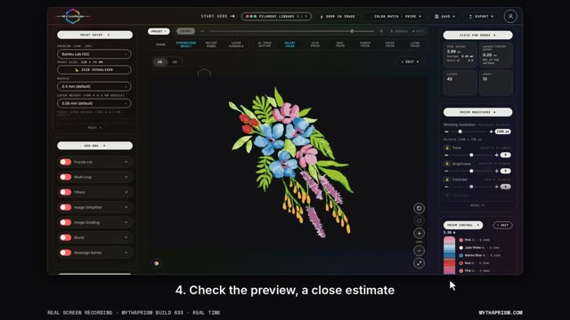</a> | **Your first print** (0:47) Drop in a picture, tick your filaments, color match, check it in 3D and export the 3MF. |
|  | **Edit before you print** (1:04) Crop it to a heart, add a few words, give it a look with Filters and Image Grading, then color match. |
| <a href="videos/03_a_gift_from_one_photo.mp4">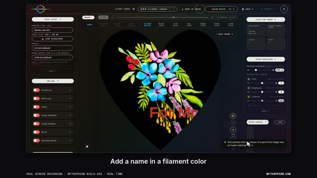</a> | **A gift from one photo** (0:51) A heart crop with a name in a filament color, matched and exported. |
| <a href="videos/04_choosing_filaments.mp4">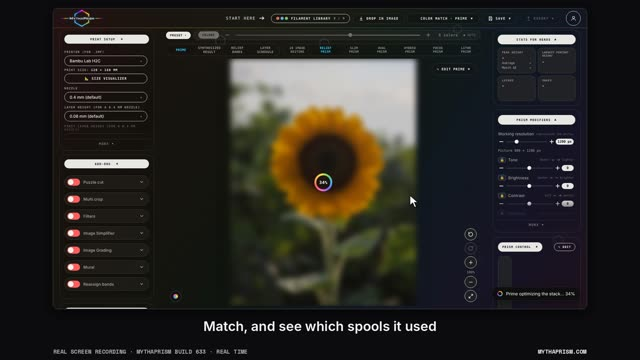</a> | **Choosing filaments** (0:35) Your library is the spools on your shelf. The matchers pick only plain PLA. |

Flowers: a commissioned painting, used with the artist's permission. Sunflower photo: A.R. The color matches use Prime, which is on the Pro plan. Black and white is free.

## Every feature, one at a time

| Video | What it shows |
|:---:|:---|
| <a href="videos/d01_one_click_color_match.mp4">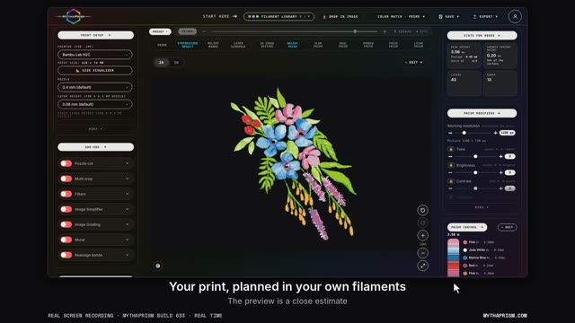</a> | **One click color match** (0:42) Drop in a photo or a painting you own · Press Color match and pick a matcher · Your print, planned in your own filaments · Hold to see the original photo · Check it in 3D before you print Prime is on the Pro plan. |
| <a href="videos/d02_filament_library.mp4">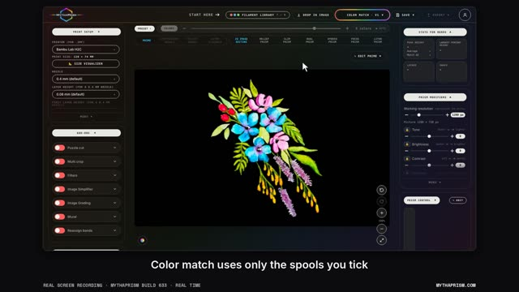</a> | **Your filament library** (0:36) Open your filament library · Your spools, in the maker's own color codes · Tap a spool to leave it out · Color match uses only the spools you tick |
| <a href="videos/d03_crop_to_a_shape.mp4">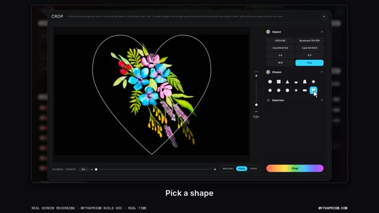</a> | **Crop to a shape** (0:20) Open Crop from the Edit menu · Pick a shape · A heart, ready to print |
| <a href="videos/d04_add_text.mp4">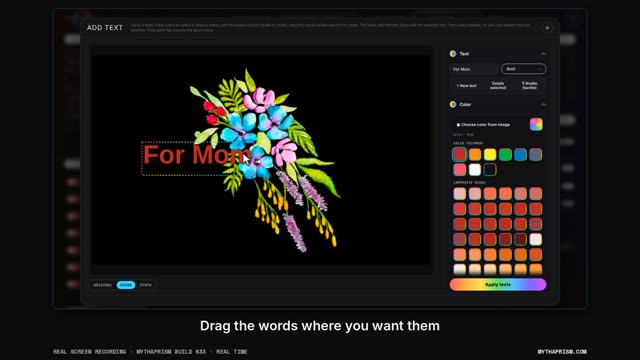</a> | **Add text** (0:25) Open Add text · Type your words · Pick the filament the words print in · Drag the words where you want them · Apply, and the text is part of the print |
| <a href="videos/d05_silhouette_cutter.mp4">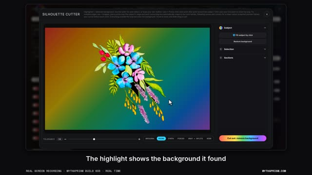</a> | **Silhouette cutter** (0:19) Silhouette cutter finds the subject · The highlight shows the background it found · Cut it out, and the background is gone |
| <a href="videos/d06_cut_out_pieces.mp4">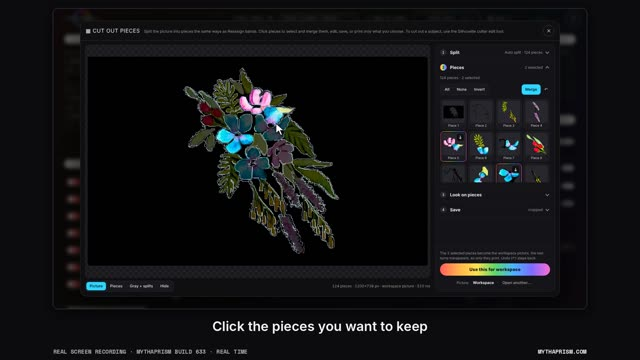</a> | **Cut out pieces** (0:33) Cut out pieces splits the picture at its colors · Less detail makes bigger pieces · Click the pieces you want to keep · See just the pieces you picked · Print only the pieces you choose |
| <a href="videos/d07_background_editor.mp4">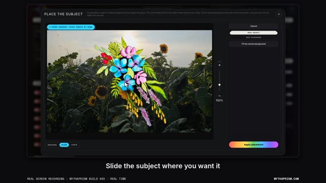</a> | **Background editor** (0:29) Open the Background editor · The Snapper finds what to keep · New background: use a second photo you own · Slide the subject where you want it · Apply, and it prints in your filaments Background photo: A.R. |
| <a href="videos/d08_filters_310_looks.mp4">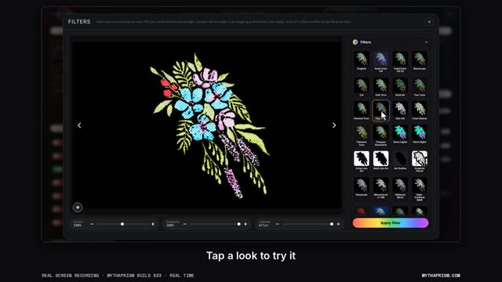</a> | **Filters: 310 looks** (0:26) Filters: 310 looks, each one shown on your photo · Tap a look to try it · Compare it with your photo |
| <a href="videos/d09_image_grading.mp4">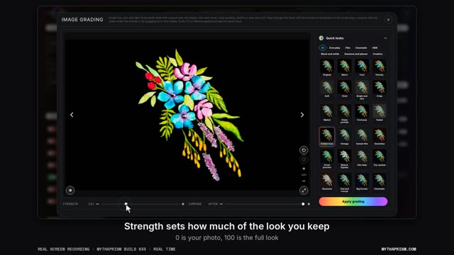</a> | **Image Grading: 53 looks** (0:35) Image Grading: 53 looks for your photo · Start from a look · Strength sets how much of the look you keep · Compare before and after |
| <a href="videos/d10_3d_preview.mp4">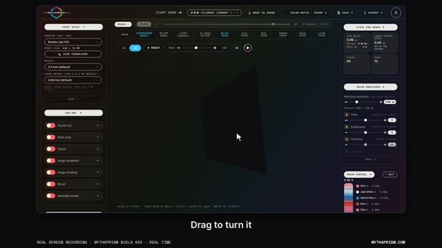</a> | **The 3D preview** (0:27) Switch to 3D · A close estimate of the print, layer by layer · Drag to turn it · Tilt it to see the layers |
| <a href="videos/d11_size_visualizer.mp4">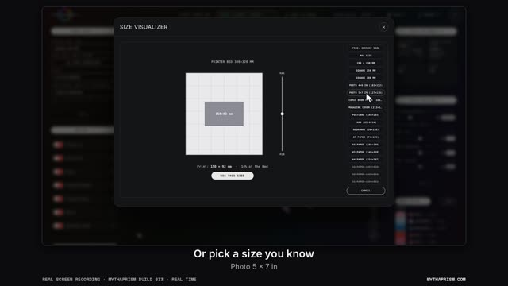</a> | **Size Visualizer** (0:23) Size Visualizer: see how big it will print · Slide to make it bigger or smaller · Or pick a size you know · Use this size |
|  | **Export the 3MF** (0:16) Export when it looks right · A 3MF for your slicer, the filament changes already planned |
| <a href="videos/d13_puzzle_cut.mp4">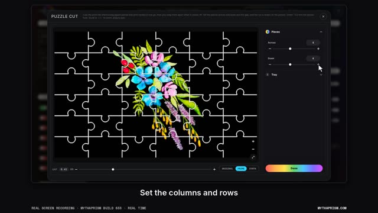</a> | **Puzzle cut** (0:19) Puzzle cut turns the print into a jigsaw · Set the columns and rows · Every piece prints with the picture on it Puzzle cut is on every plan. |
| <a href="videos/d14_mural.mp4">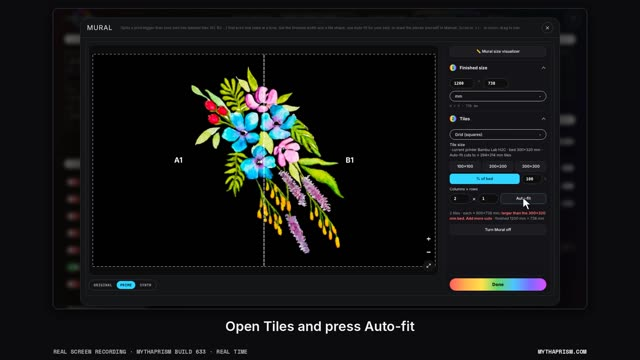</a> | **Mural** (0:22) Mural: one picture across many prints · Type the finished width · Open Tiles and press Auto-fit · 15 tiles, each one fits your printer bed |
| <a href="videos/d15_multi_crop.mp4">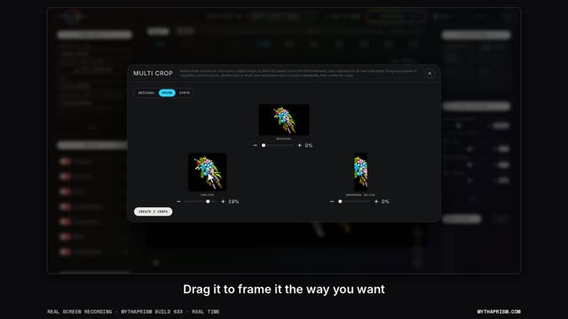</a> | **Multi crop** (0:28) Multi crop: several prints from one photo · Three shapes at once · Round the corners of one · Drag it to frame it the way you want · Each crop becomes its own print |
| <a href="videos/d16_spot_color.mp4">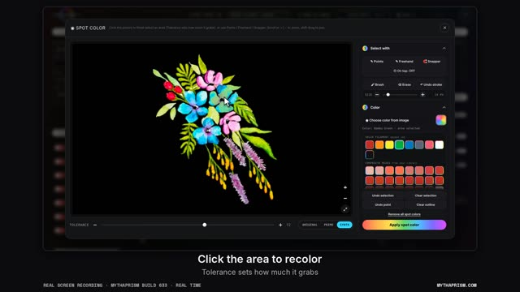</a> | **Spot color** (0:26) Spot color recolors one area · Pick a filament from your library · Click the area to recolor · Apply, and it prints in that filament |
| <a href="videos/d17_presets.mp4">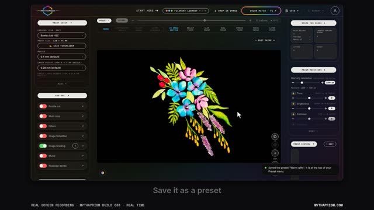</a> | **Presets** (0:36) Grade a photo the way you like it · Save it as a preset · Load the next photo · Apply the preset in one click Photo used with the photographer's permission. |
|  | **Prism Modifiers** (0:28) Prism Modifiers change the print itself · Lock one, and a new match keeps it |
| <a href="videos/d19_any_photo.mp4">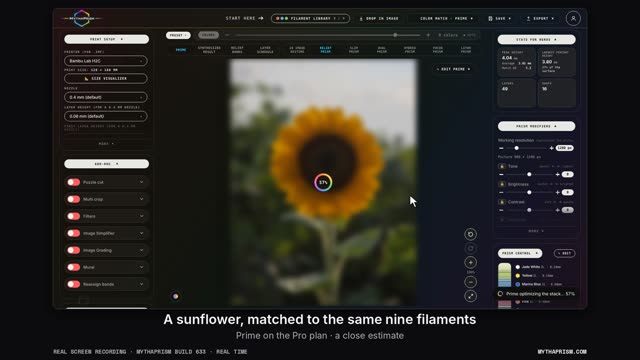</a> | **Any photo, the same nine filaments** (2:22) A butterfly · A butterfly, matched to the same nine filaments · A bumblebee · A bumblebee, matched to the same nine filaments · A sunflower Butterfly and waterfall photos used with the photographer's permission. Bumblebee, sunflower and cat photos: A.R. |
| <a href="videos/d20_recrop.mp4">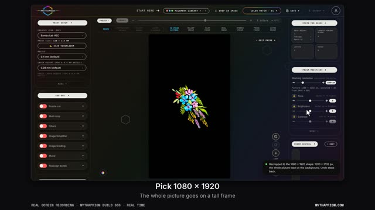</a> | **Recrop** (0:19) Recrop keeps the whole picture · Pick 1080 x 1920 · Nothing is cut off |
| <a href="videos/d21_your_own_lut.mp4">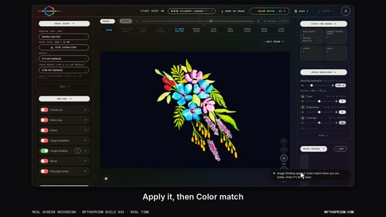</a> | **Your own .cube LUT** (0:40) Image Grading reads your own .cube LUT · Open Your LUT and load the file · Compare before and after · Apply it, then Color match The LUT was made by MythaPrism for the demo. |
| <a href="videos/d22_image_simplifier.mp4">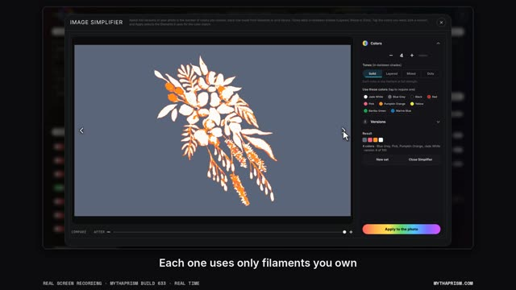</a> | **Image Simplifier** (0:25) Image Simplifier: about 100 versions of your photo in fewer colors · Each one uses only filaments you own · Add a color · Pick one and apply it |
|  | **Six print modes** (0:52) One picture, six ways to print it · Relief: height for every color · Slim: a flat color print a few layers thick · Dual: a picture on each side · Hybrid: relief on one side, flat on the other |
| <a href="videos/n01_dual_prism_two_sides.mp4">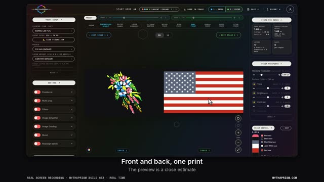</a> | **Dual Prism: a picture on each side** (0:00) Dual Prism: a picture on each side · Choose the picture for the back · Color match the front · Then the back · Front and back, one print U.S. flag: public domain. |
| <a href="videos/n02_hybrid_prism.mp4">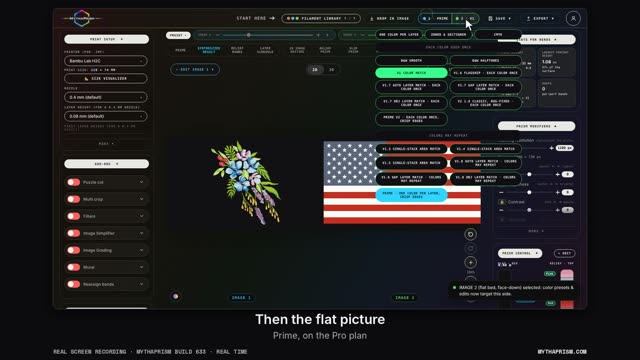</a> | **Hybrid Prism** (1:05) Hybrid Prism: relief on top, a flat picture underneath · Choose the flat picture for the bed side · Color match the relief · Then the flat picture · Turn it all the way round U.S. flag: public domain. |
| <a href="videos/n03_lithoprism.mp4">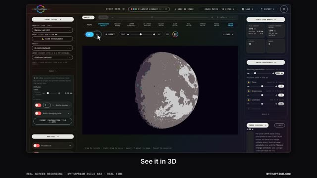</a> | **LithoPrism** (0:29) LithoPrism: a color lithophane · Hold it up to a light · See it in 3D Moon: NASA Scientific Visualization Studio. NASA does not endorse MythaPrism. |
| <a href="videos/n05_the_sun.mp4">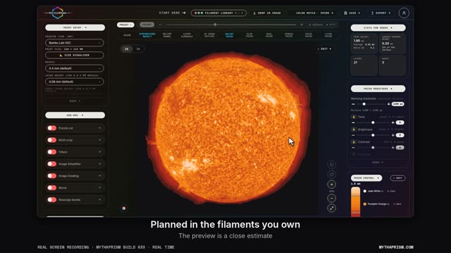</a> | **The Sun, in filament** (0:38) The Sun · Color match it · Planned in the filaments you own · Check it in 3D Photo: NASA/SDO. NASA does not endorse MythaPrism. |

## Your own photos

Photos A.R. took, printed in the filaments you own. Real screen recordings of MythaPrism build 633 at real speed.

| Video | What it shows |
|:---:|:---|
| <a href="videos/z01_dual_tiger_and_parrot.mp4">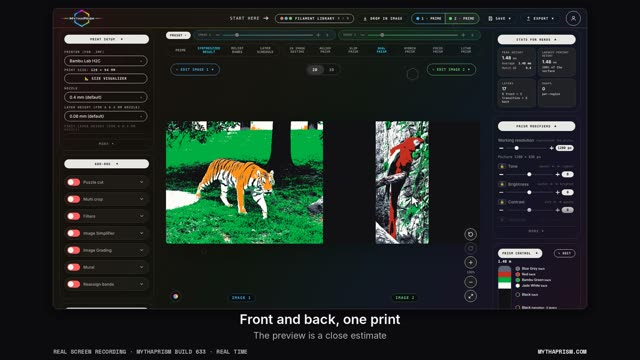</a> | **Dual Prism: the tiger and the parrot** (1:00) Dual Prism: a picture on each side · Choose the picture for the back · Color match the front · Then the back · Front and back, one print |
| <a href="videos/z02_tiger.mp4">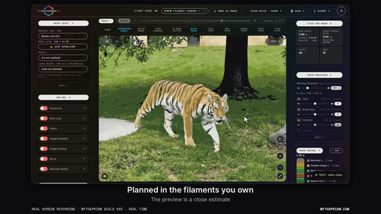</a> | **The tiger, color matched** (0:55) A tiger I photographed · Color match it · Planned in the filaments you own · Hold to see the original photo · See it in 3D |
| <a href="videos/z03_parrot.mp4">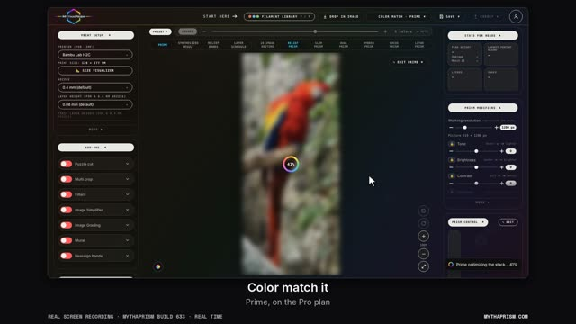</a> | **The parrot, color matched** (0:38) A parrot I photographed · Color match it · Planned in the filaments you own · Hold to see the original photo |
| <a href="videos/z04_any_photo.mp4">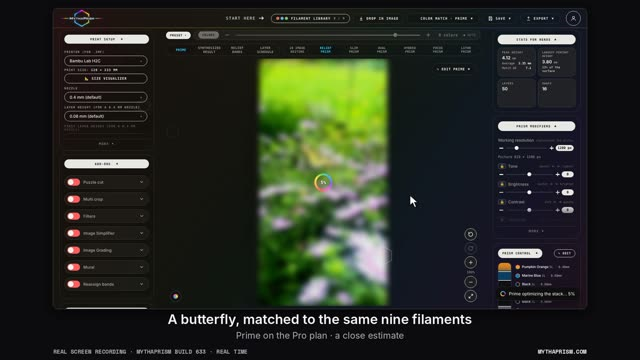</a> | **Your photos, the same nine filaments** (2:25) A tiger · A tiger, matched to the same nine filaments · A parrot · A parrot, matched to the same nine filaments · A butterfly |

Tiger photo: A.R., at the Virginia Safari Park. Parrot photo: A.R., at the National Aquarium in Baltimore. Used with each place's permission, and neither one endorses MythaPrism. Butterfly photo used with the photographer's permission. Bumblebee and sunflower photos: A.R. Prime is on the Pro plan.

## Dithering: ultra detailed prints

Dithering mixes your filaments dot by dot, so a photo prints with fine detail and smooth tones. It works with up to 4 colors, and 2 or 3 look best. Dither 1.0 and 2.0 come with Plus, 3.0, 4.0 and 4.5 with Pro.

| Video | What it shows |
|:---:|:---|
| <a href="videos/dither_tiger.mp4">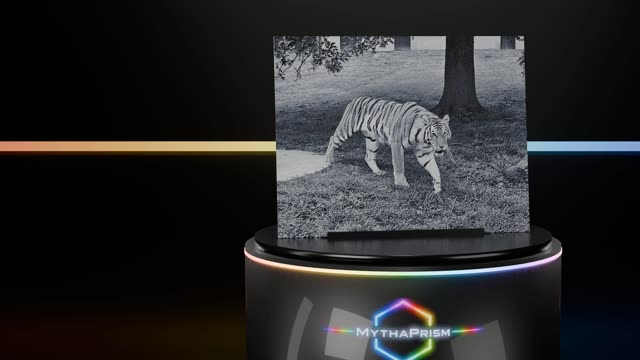</a> | **The tiger, dithered** (0:08) Family portrait with Dither 4.5, three filaments, on the Showroom stage |
| <a href="videos/dither_blossoms.mp4">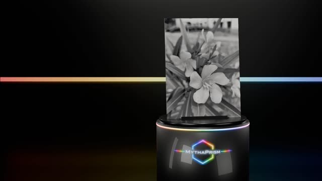</a> | **Blossoms, dithered** (0:08) Monochrome with Dither 4.5, black and white, on the Showroom stage |

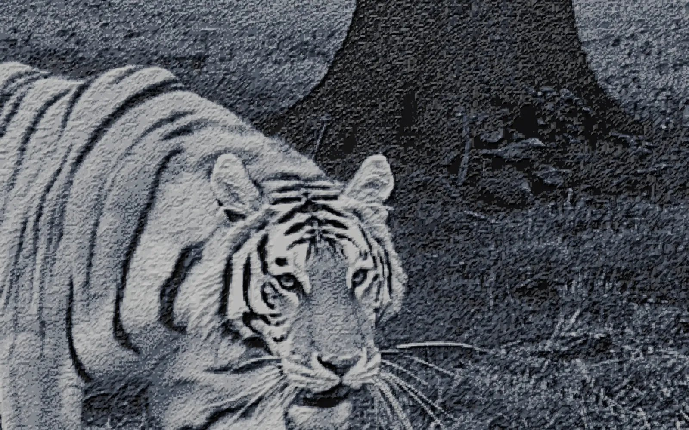

Blender renders (Cycles) of real MythaPrism exports (build 635) on the Showroom stage, a close estimate of the print, not a photo of one. Tiger and blossoms photos: A.R.

## The Showroom in Blender

<a href="videos/showroom_reel.mp4">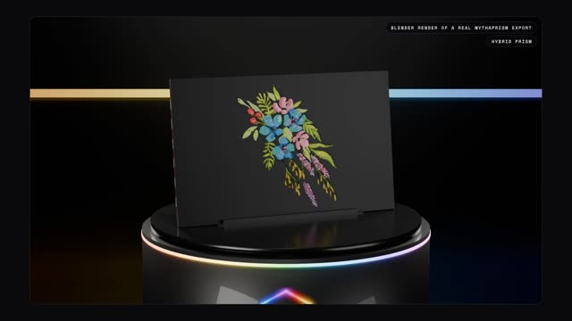</a>

Blender renders (Cycles) of real MythaPrism exports, made with the MythaPrism Plug-in and Showroom. A render is a close estimate of a print, not a photo of one.

## Short clips

Short clips from MythaPrism. Each one says what it is. The preview in each clip is a close estimate of the printed result.

## Auto color match: drop in a photo, match it to your filaments, then the same export on the Showroom stage

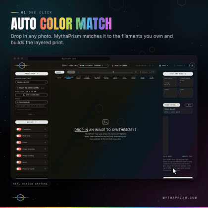

Real screen recording, then a Blender render of the export (not a photo of a print).

## The photo editor: cut out, background, grading, text and a heart crop

Real MythaPrism edits.

## See it in 3D: a Dual print turned in the 3D view

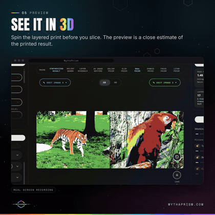

Real screen recording.

## Pick a print mode: Relief, Slim, Dual, Hybrid, Focus and LithoPrism

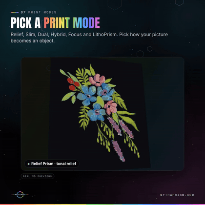

Real 3D previews turned by hand.

## Any photo, full color: space photos and paintings matched to filaments

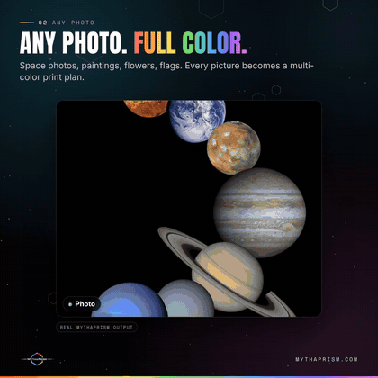

Real MythaPrism output, NASA pictures (public domain, NASA does not endorse MythaPrism).

The full demo, recorded in real time, is on the [website](https://mythaprism.com/#demo).
