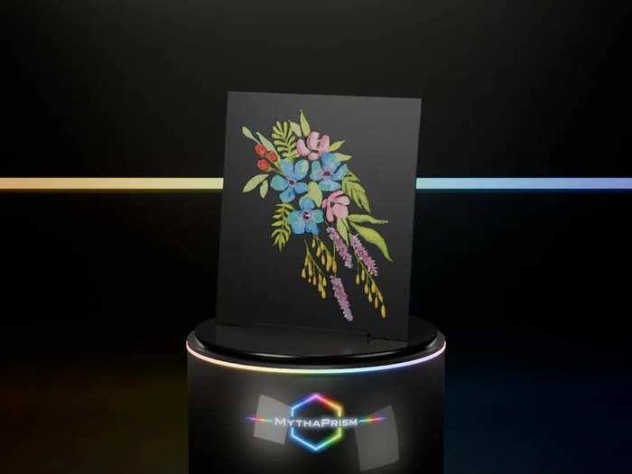

# The Plug-in and Showroom for Blender

Blender render of a real MythaPrism export on the Showroom stage, not a photo of a print.

The MythaPrism Plug-in and Showroom is a plug-in made for Blender (4.2 and newer, on Windows, macOS and Linux). It brings your print into Blender at its true size and in its real filament colors, with one collection per filament.

- **Showroom.** A ready stage with lights and a turntable, so you can render your print before you print it.
- **Real light.** Each filament lets light through by its light depth, so a render looks closer to the real print.
- **Build on it.** Add a frame, a stand or text in Blender, then send the whole thing back to your slicer as one 3MF.

The plug-in comes with the Studio Bundle, or you can buy it once for any other plan. The [prices page](https://mythaprism.com/#pricing) has the details.

Without the plug-in, Blender's own File, Import, glTF 2.0 opens the .glb export too.

Blender is a trademark of the Blender Foundation. The plug-in is made by MythaPrism LLC and is not made or endorsed by the Blender Foundation.
