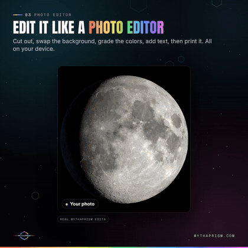
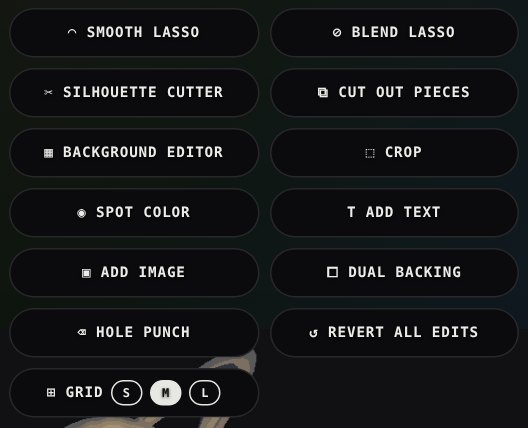

# Edit tools and add-ons

Every picture opens as a photo first. You can edit it before any colors are matched, and the print follows your edits.

Real MythaPrism edits: cut out, background, grading, text, and a heart crop.

## Edit tools

- **Crop**, to a rectangle or a shape such as a circle or a heart.
- **Cut out pieces** and the **Silhouette cutter**, to lift the subject out of the picture.
- **Background editor**, to change or remove what is behind the subject.
- **Spot color**, to paint a part of the picture with one filament.
- **Add text** and **Add image**, including braille under text.
- **Smooth lasso** and **Blend lasso**, to tidy an area.
- **Hole punch**, for a keyring or a hanging hole.
- **Dual backing**, the picture on the back of a Dual print.
- **Revert all edits** puts the photo back the way it came in.

 

## Add-ons

- **Filters** restyle the photo before it is matched.
- **Image Grading** adjusts light, white balance and color, and reads your own .cube color look on your device.
- **Image Simplifier** shows many versions of the photo in a set number of filament colors, so you can pick a clean one.
- **Puzzle cut** cuts the print into interlocking pieces, with a matching tray.
- **Multi crop** makes several crops from one photo.
- **Mural** splits a print bigger than your build plate into labeled tiles.

Which tools and add-ons you get depends on your plan. The [prices page](https://mythaprism.com/#pricing) lists them.

## Prism Modifiers

The sliders under **Prism Modifiers** (tone, brightness, contrast and more) change the photo and the print together, so you can see the result right away.
