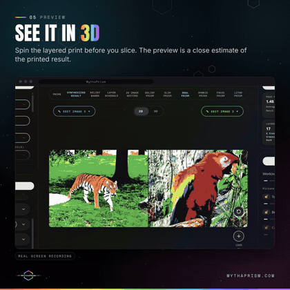

# Export, slice and print

Real screen recording of the 3D view on a Dual print.

## What you get

Press **Export** and you get a print-ready **.3mf**. You can also save an **STL** with a swap guide, a **shareable PDF** that lists the filaments and layer changes, or the whole project to open again later. On Pro you can also export for Blender and other 3D apps (.glb and .obj with the filament colors).

## Opening it in your slicer

- **Bambu Studio, OrcaSlicer and PrusaSlicer** open the 3MF as a ready project with the filament changes built in.
- **Any other slicer that reads 3MF** opens it as geometry, and the shareable PDF tells you where to change filament.

The first time you export, MythaPrism shows a short note about slicing. Please read it once.

## Printers

Every current Bambu Lab printer, Prusa XL and CORE One, Snapmaker U1 and FlashForge Creator 5 are built in. On Plus and Pro you can import your own printer profile (a Bambu Studio printer preset bundle, an OrcaSlicer preset bundle or a PrusaSlicer config), and then every export opens on your own presets. The profile is read on your device.

## Tips for a good print

- Check that the filament slots in your slicer match the colors in the PDF before you start.
- Print the first layer slowly. A clean first layer matters most on thin, flat prints.
- Look at the print in normal light from the front, the way the preview shows it. LithoPrism prints are the exception: hold them up to a light.
- If a color looks off, a [calibration](color-matchers.md#calibration) on Plus or Pro brings the preview closer to your spools.

## Free sample files

Ready-to-print samples made in MythaPrism are in [prints/](../prints), so you can check that our files print on your printer before you buy anything.
