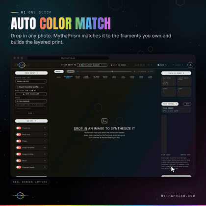

# Getting started: your first print

You need a photo, a 3D printer and a slicer such as Bambu Studio, OrcaSlicer or PrusaSlicer. You do not need to know 3D modeling.

Real screen recording of the tool, then a Blender render of the same export on the Showroom stage.

## 1. Open the tool

Open the free tool at [tool.mythaprism.com](https://tool.mythaprism.com). It runs in your browser, and you can use it without signing in. The first time it opens, it asks you to read and accept the Terms, and it can show you a short walkthrough. You can open the walkthroughs again from the person icon at the top right.

## 2. Tell it your printer

Under **Print setup**, pick your printer, nozzle and layer height. The defaults suit most prints. On Plus and Pro you can also import your own printer profile, so every export opens on your own presets.

## 3. Pick your filaments

Open the **Filament library** and turn on the spools you actually own. The color matchers only use the filaments you select. On the free plan the colors are black and white.

## 4. Drop in a picture

Press **Drop in image** or drag a photo onto the page. It opens as a photo first, so you can crop it, cut out the subject, change the background, add text and more before any colors are matched. See [Edit tools and add-ons](editing.md).

## 5. Color match

Press **Color match**. MythaPrism works out which filament goes where and how many layers each part needs. You can pick a different color matcher from the same menu and compare the looks. See [Color matchers](color-matchers.md).

## 6. Check it in 3D

Switch to the 3D view and turn the print with your mouse or finger. The preview is a close estimate of the printed result. Your printer, your spools and the light in the room all change the real print a little.

## 7. Export

Press **Export** and save the 3MF. Bambu Studio, OrcaSlicer and PrusaSlicer open it as a ready project with the filament changes built in. On the free plan you need a free account to download, and the free account includes a monthly number of downloads. See [Export, slice and print](export-and-slicing.md).

## 8. Print it

Slice, check the filament list in your slicer, and print. Then show us in the [issues](../../../issues/new/choose) with the print result form.
