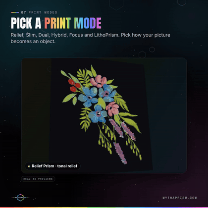
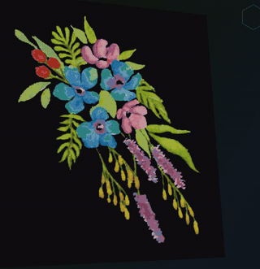
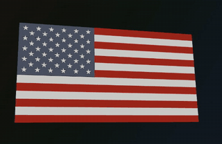
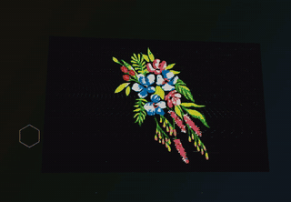
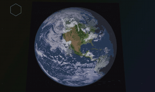
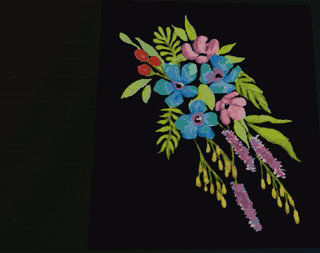
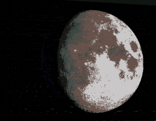

# Print modes

The mode decides how your picture becomes an object. You can switch modes at any time, and the color match follows.

Real 3D previews of each mode, turned by hand in the MythaPrism 3D view.

| Mode | What you get | Plan |
|:---|:---|:---|
|  **Relief Prism** | The picture rises out of the plate in stacked layers that turn light into full color, so it has real sculpted depth. | Free, Plus, Pro |
|  **Slim Prism** | Flat, full-color panels kept as thin as possible, for posters, coasters, signs and keytags. Face up or face down. | Plus, Pro |
|  **Dual Prism** | Two pictures in one print, one on the front and one on the back, with a transition band between them so neither shows through. | Plus, Pro |
|  **Hybrid Prism** | A sculpted color relief on top and a second picture printed flat and face down underneath. | Pro |
|  **Focus Prism** | A raised subject over a soft background, with the base color printed under both. | Pro |
|  **LithoPrism** | A full-color lithophane. It glows when you hold it up to a light. It also makes the classic white lithophane from one filament. | Pro |

There is also **2D image editing**, where you work on the picture as a photo before you print it.

## Which one should I pick?

- A picture to hang or stand on a shelf: **Relief Prism**.
- A thin, flat piece such as a coaster, a sign or a keytag: **Slim Prism**.
- A two-sided ornament or gift: **Dual Prism**.
- Something for a window or a lamp: **LithoPrism**. It is made to be lit from behind, and that is when the colors show. The other modes are made to be seen from the front in normal light, the same way the preview shows them.
