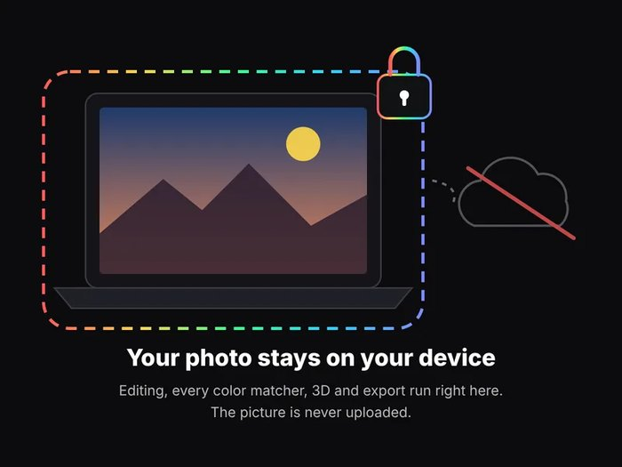

# Your photos and your privacy

**Your photos stay on your device.** Editing, every color matcher, the 3D view and the export all run in your browser or on your phone. The picture, its file name and its metadata are never uploaded, so we never receive or store them.

What an account keeps is small: your e-mail address and how you sign in, your plan, the devices you signed in on, which version of the Terms you accepted and, on a free account, your download count.

## Reports and posts here

Everything posted in this repository is public. A report sent with **Report a bug** inside MythaPrism is posted here with a short code instead of your name or e-mail, and never with your pictures. If you post here with your own GitHub account, GitHub's own terms and privacy statement apply too.

Please keep account, payment and refund questions out of public posts and write to **support@mythaprism.com**. To have a report or a post taken down, write to the same address.

The full [Privacy Policy](https://mythaprism.com/privacy.html) and [Terms](https://mythaprism.com/terms.html) are on the website.
